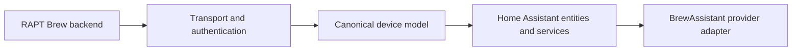

# Architecture

## Purpose

HA-RAPTBridge isolates vendor-specific RAPT Brew communication from the
stable state and command contract consumed by Home Assistant and
BrewAssistant.

The vendor API is treated as an external transport, not as the internal data
model of the integration.

## Layers

### 1. Transport and authentication

Responsibilities:

- authenticate without storing credentials in diagnostics or logs;
- discover devices and capabilities;
- fetch or subscribe to state;
- send supported commands;
- handle token refresh, rate limits and transient failures;
- retain raw vendor payloads only long enough to normalize and redact them.

No Home Assistant entity should depend directly on an undocumented raw field.

### 2. Canonical device model

The canonical model is provider-independent. The initial BrewZilla state is
expected to include:

- device identity and model;
- provider availability and connection state;
- observation timestamp and provider timestamp;
- internal temperature;
- external/control-device temperature;
- target temperature;
- heating enabled and heating utilisation;
- pump enabled and pump utilisation;
- PID state where available;
- active profile/session and step information;
- explicit freshness and rejection diagnostics.

Missing values remain missing. Zero, false and unavailable are not
interchangeable.

### 3. Home Assistant surface

The integration will use the new domain `rapt_brew_bridge`.

Platforms are expected to include:

- `sensor` for temperatures, freshness and diagnostics;
- `binary_sensor` for profile/runtime state and capability indicators;
- `switch` for supported boolean controls;
- `number` for target temperature and utilisation;
- integration services only where a normal entity model is insufficient,
  such as profile start/end.

Entity unique IDs must be based on stable RAPT device identifiers, not device
names.

### 4. BrewAssistant provider adapter

BrewAssistant should consume a logical provider contract rather than raw
entity IDs or RAPT field names.

During migration, BrewAssistant may select either:

- legacy provider: `rapt_cloud_link`;
- new provider: `rapt_brew_bridge`.

The adapter owns provider selection and source arbitration. HA-RAPTBridge owns
only RAPT Brew communication and state normalization.

## State flow

1. The transport receives a provider response or pushed event.
2. Raw data is validated and normalized.
3. The coordinator publishes a complete canonical snapshot.
4. Home Assistant entities render that snapshot.
5. BrewAssistant reads state and freshness before proposing or issuing a
   command.

Partial responses must not erase unrelated state unless the provider explicitly
marks those fields absent.

## Command flow

1. BrewAssistant determines an action.
2. In supervised mode, the operator confirms it.
3. The Home Assistant entity/service validates range and capability.
4. The transport sends the command once.
5. The integration requests or waits for a fresh device observation.
6. Only observed state confirms success.

A transport acknowledgement means "accepted by the backend", not "physically
applied by the device".

## Safety invariants

- No command is emitted from a coordinator update.
- No automatic OFF, STOP or zero-utilisation command is emitted because an API
  call failed or state became unavailable.
- Commands are rejected while provider freshness or device identity is
  uncertain.
- Heating and pump controls expose explicit capability information.
- Repeated command retries are bounded and never hidden from diagnostics.
- Profile STOP is confirmed from fresh runtime state, not from the end-command
  response alone.
- Debug payloads are redacted and bounded before entering the Home Assistant
  state machine.

## Side-by-side validation

The new domain permits both integrations to run simultaneously. Validation
compares semantic values, timestamps and command outcomes without entity-ID
collisions.

The legacy integration remains authoritative until:

- read-only parity is demonstrated over a full brew-day state range;
- stale/unavailable behaviour is verified;
- each physical command is tested individually in supervised mode;
- BrewAssistant provider switching is reversible.

## Open architecture decisions

- official new API authentication and token lifecycle;
- polling, push transport or a hybrid;
- whether the new backend exposes profile/session control;
- provider rate limits and minimum safe polling interval;
- exact command acknowledgement and error semantics;
- whether bonded BLE temperatures are exposed through BrewZilla, as standalone
  devices, or both;
- migration strategy for users who want old entity IDs after cutover.
